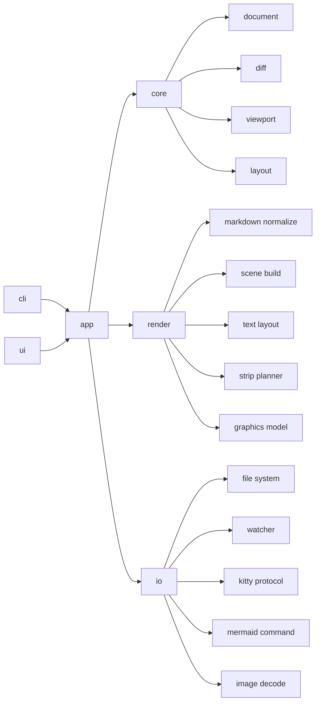
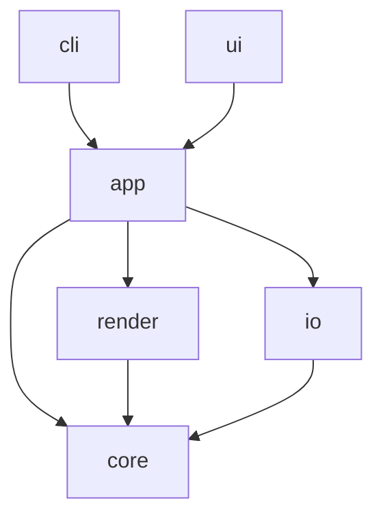
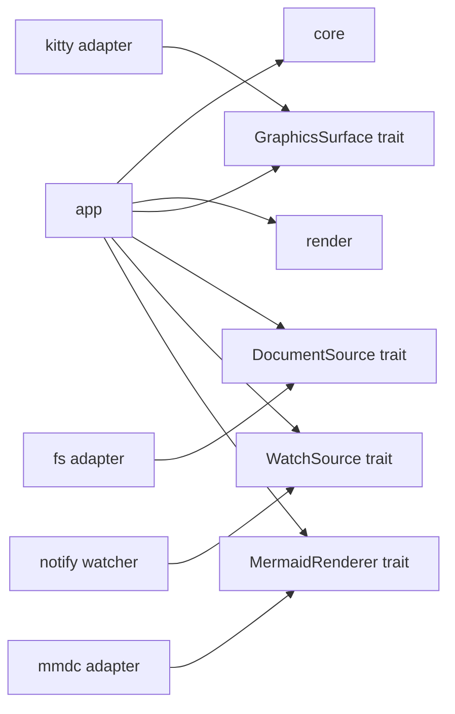
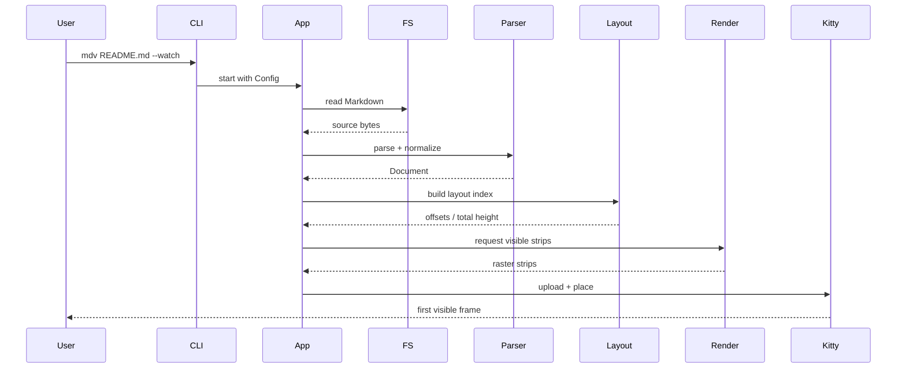
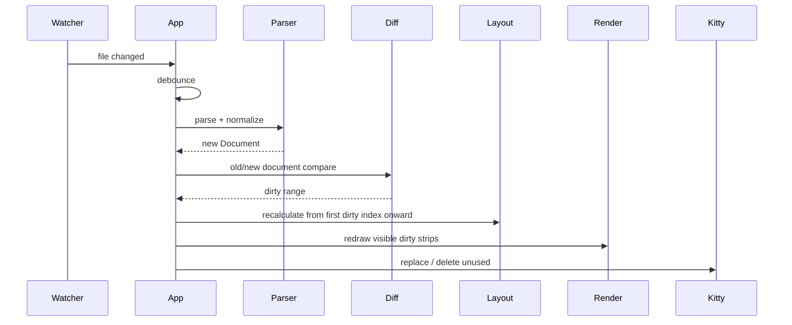
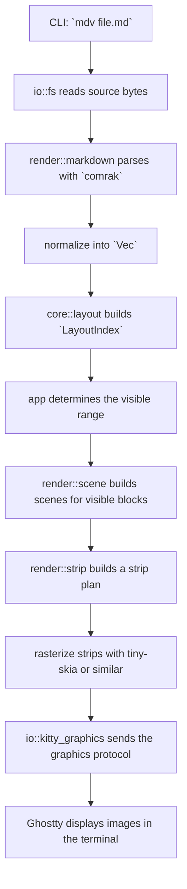
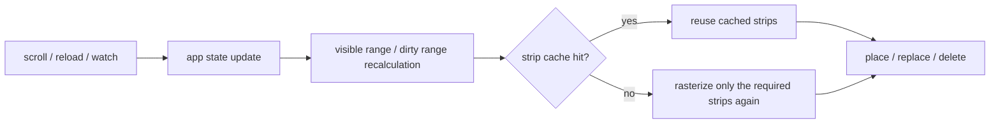
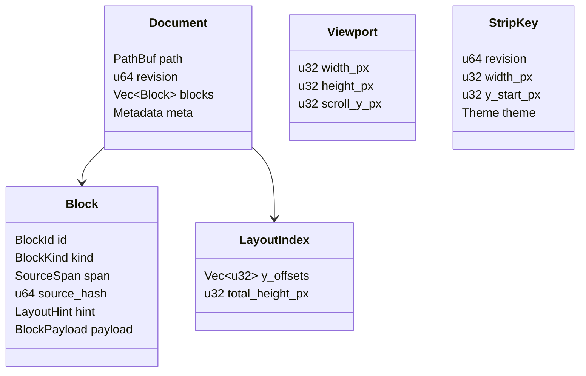

# `mdv` Initial Development Design

| Item | Value |
| --- | --- |
| Version | 0.3 |
| Status | Draft |
| Owner | Asuma |
| Product | `mdv` |
| Language | Rust |
| Primary Runtime | Single binary, single interactive process |
| Primary Platforms | macOS / Linux |
| Primary Terminals | Ghostty / Kitty |
| Related Doc | [`docs/PRD.md`](../PRD.md) |

---

## 1. Purpose of This Document

This document is a **technical design detailed enough to begin implementing the `mdv` MVP**.

`docs/PRD.md` covers:

- What to build
- Which users and problems to address
- How narrowly to define the MVP scope

This document covers:

- How to implement it
- Which crates and tools to adopt
- Which data structures and responsibility boundaries to use
- The implementation order

---

## 2. Design Summary

Implement `mdv` as a **Rust viewer that normalizes local Markdown into blocks, rasterizes strips with visible content first, and displays them through the Kitty graphics protocol**.

The MVP has six core elements:

1. Parse Markdown into an AST with `comrak` and normalize it into a custom `Block` model.
2. Store the document as a sequence of blocks such as paragraphs, headings, code, tables, images, and Mermaid diagrams.
3. Build a block layout and a strip-based render plan from that sequence.
4. Rasterize only the visible range and its surroundings.
5. Display incremental updates to the generated strips through the Kitty graphics protocol.
6. On `watch` or `reload`, relayout only from the dirty block onward and redraw only the required strips.

---

## 3. Design Decisions

### 3.1 Key Architecture Decisions

| Topic | Decision | Why |
| --- | --- | --- |
| Execution model | Single binary, single interactive process | Simplify operation, distribution, and debugging |
| Module structure | Pragmatic modular layering rather than strict clean architecture | `markdown`, `graphics`, and `render` are core product capabilities, not merely infrastructure |
| Rendering strategy | Custom scene renderer + strip rasterization | Implementable entirely in Rust, with deterministic layout and straightforward incremental updates |
| Document model | Block-oriented | Stabilize the units used for diffing, reloading, and caching |
| Display unit | Full-width vertical strip | Suits a viewer centered on vertical scrolling |
| Priority | Visible-first | Prioritize perceived speed |
| Mermaid | Abstract behind an adapter; generate SVG when a renderer is available, otherwise use a degraded display | Avoid blocking core implementation on Mermaid |

### 3.2 Changes from the Previous Proposal

The previous proposal emphasized rasterizing HTML fragments together, but the MVP will not adopt that approach.

The reasons are:

- High-fidelity HTML/CSS rasterization is difficult to implement entirely in Rust
- Bundling an HTML/CSS engine complicates the single-binary approach and increases compilation cost
- The viewer needs reliable Markdown block rendering rather than browser compatibility

For the MVP, it is therefore more practical to **normalize Markdown into a custom scene model and directly lay out text, code, boxes, and images**.

### 3.3 How Much Clean Architecture to Adopt

`mdv` will **not adopt strict clean architecture**.

The reasons are:

- Markdown parsing is a core viewer capability rather than an outer supporting function
- Graphics and rasterization are also close to domain-level core logic in this product
- Forcing them into `infrastructure` would make the folder structure less meaningful
- Unlike a web app or business CRUD application, a viewer centers on the rendering pipeline itself

For testability, however, **use traits to separate boundaries that are likely to change**.

Candidates for traits include:

- filesystem read
- file watch
- terminal graphics surface
- external Mermaid command execution

Do not require traits from the outset in these areas:

- block normalize
- layout / diff
- scene build
- strip planning
- text layout orchestration

The approach is **pragmatic structure with selective abstraction at boundaries**.

---

## 4. Architecture Overview

### 4.1 Logical Structure



### 4.2 Dependency Direction



The dependency rules are:

- `core` contains pure logic for the document model, diffing, viewport, and layout
- `render` is central to `mdv` and handles Markdown normalization and strip render planning
- `io` connects to files, watchers, external commands, and terminal graphics
- `app` coordinates scrolling, reloading, resizing, and watching
- `ui` handles terminal events and overlays
- `cli` accepts configuration input

### 4.3 Boundaries for Testability

Introduce **port-like abstractions only where they provide substantial testing value**, as shown below.



---

## 5. Reference Implementations

Do not copy existing implementations verbatim. Clarify **what to learn from them and what to leave out**.

| Project | Learn From | Do Not Adopt |
| --- | --- | --- |
| `awrit` | Kitty graphics protocol handling, image lifecycle, and terminal graphics cleanup | Responsibilities of a full browser, web navigation, and a complex event model for DOM applications |
| `flint` | Markdown viewer UX, emphasis on Mermaid, images, tables, and callouts, and controls such as `j/k` | A Textual-based widget tree and a structure that assumes a Python runtime |

Their roles in this project are:

- `awrit` is a **reference for the graphics adapter**
- `flint` is a **reference for viewer UX and feature prioritization**
- `mdv` takes its own approach as a single-binary Rust viewer

---

## 6. Execution Sequences

### 6.1 From Startup to First Render



### 6.2 On a `watch` Update



### 6.3 Ghostty rendering flow



Ghostty displays **strip images built from blocks and a minimal text overlay**, rather than the Markdown source itself.

### 6.4 Redraw Flow for Scrolling and Reloading



---

## 7. Recommended Folder Structure

The following is the **target structure for the implementation**. The repository is currently at the bootstrap stage and will gradually move toward this structure.

```text
mdv/
├─ Cargo.toml
├─ rust-toolchain.toml
├─ Makefile
├─ src/
│  ├─ main.rs
│  ├─ lib.rs
│  ├─ cli/
│  │  ├─ mod.rs
│  │  └─ args.rs
│  ├─ app/
│  │  ├─ mod.rs
│  │  ├─ controller.rs
│  │  ├─ actions.rs
│  │  ├─ scheduler.rs
│  │  └─ state.rs
│  ├─ core/
│  │  ├─ mod.rs
│  │  ├─ document/
│  │  │  ├─ mod.rs
│  │  │  ├─ block.rs
│  │  │  ├─ inline.rs
│  │  │  └─ ids.rs
│  │  ├─ layout/
│  │  │  ├─ mod.rs
│  │  │  ├─ viewport.rs
│  │  │  ├─ index.rs
│  │  │  └─ range.rs
│  │  ├─ diff/
│  │  │  ├─ mod.rs
│  │  │  └─ block_diff.rs
│  │  ├─ theme.rs
│  │  └─ config.rs
│  ├─ render/
│  │  ├─ mod.rs
│  │  ├─ markdown/
│  │  │  ├─ mod.rs
│  │  │  ├─ normalize.rs
│  │  │  └─ gfm.rs
│  │  ├─ scene/
│  │  │  ├─ mod.rs
│  │  │  ├─ nodes.rs
│  │  │  └─ builder.rs
│  │  ├─ text/
│  │  │  ├─ mod.rs
│  │  │  ├─ layout.rs
│  │  │  └─ highlight.rs
│  │  ├─ strip/
│  │  │  ├─ mod.rs
│  │  │  ├─ planner.rs
│  │  │  └─ cache.rs
│  │  ├─ graphics/
│  │  │  ├─ mod.rs
│  │  │  ├─ model.rs
│  │  │  └─ placement.rs
│  │  └─ mermaid/
│  │     ├─ mod.rs
│  │     ├─ model.rs
│  │     └─ cache.rs
│  ├─ io/
│  │  ├─ mod.rs
│  │  ├─ fs.rs
│  │  ├─ watcher.rs
│  │  ├─ kitty_graphics.rs
│  │  ├─ mermaid_cli.rs
│  │  ├─ image_decoder.rs
│  │  └─ browser.rs
│  ├─ ui/
│  │  ├─ mod.rs
│  │  ├─ events.rs
│  │  ├─ overlay.rs
│  │  └─ screen.rs
│  ├─ ports/
│  │  ├─ mod.rs
│  │  ├─ document_source.rs
│  │  ├─ watch_source.rs
│  │  ├─ graphics_surface.rs
│  │  └─ mermaid_renderer.rs
│  └─ support/
│     ├─ mod.rs
│     ├─ error.rs
│     └─ metrics.rs
├─ tests/
│  ├─ unit.rs
│  ├─ integration.rs
│  ├─ e2e.rs
│  ├─ unit/
│  ├─ integration/
│  ├─ e2e/
│  ├─ fixtures/
│  └─ snapshots/
└─ docs/
   ├─ PRD.md
   └─ plan/
      └─ init.md
```

### 7.1 Module Responsibilities

| Path | Responsibility |
| --- | --- |
| `src/core` | Pure logic for the document model, layout, diffing, and themes |
| `src/render` | Markdown normalization, scene building, strip planning, and rendering logic |
| `src/app` | Use cases, state transitions, and scheduler |
| `src/io` | Connections to the filesystem, watching, Kitty graphics, and external commands |
| `src/ui` | terminal event loop, overlay, screen lifecycle |
| `src/cli` | Argument parsing and configuration input |
| `src/ports` | Central location for any boundary traits |
| `src/support` | Errors, metrics, and shared helpers |

### 7.2 Criteria for Introducing Traits

| Area | Use a Trait | Reason |
| --- | --- | --- |
| file read / write | yes | Keep integration tests lightweight |
| file watch | yes | Make debounce behavior and watch events easy to substitute |
| kitty graphics surface | yes | Allow substitution with a dry-run renderer |
| Mermaid external command | yes | Make renderer availability easy to control in tests |
| markdown normalize | no | Central to the implementation, with little value in substitution |
| layout / diff | no | Pure function tests are sufficient |
| scene builder | no | Well suited to snapshot tests |
| strip planner | no | Well suited to pure logic tests |

### 7.3 Test Structure

| Path | Scope |
| --- | --- |
| `tests/unit/` | Pure core and app logic |
| `tests/integration/` | Integration across multiple components within the crate |
| `tests/e2e/` | Launching the actual binary, CLI UX, and local file integration |
| `tests/fixtures/` | Markdown and image fixtures |
| `tests/snapshots/` | `insta` snapshot |

Use `tests/unit.rs`, `tests/integration.rs`, and `tests/e2e.rs` as entry points for their respective directories so Cargo can discover them automatically.

---

## 8. GFM Support Strategy

### 8.1 Current Status

**The project cannot yet claim to render correctly.**

The repository currently contains only the CLI bootstrap; the actual renderer has not been implemented. This design therefore clarifies **how to implement GFM support**.

### 8.2 parse layer

The parsing layer uses `comrak`. Its docs.rs documentation explicitly describes it as a **CommonMark- and GFM-compatible parser**.

### 8.3 GFM Rendering Targets for the MVP

| Feature | Parse | Render Target in MVP |
| --- | --- | --- |
| headings / emphasis / lists | yes | yes |
| fenced code blocks | yes | yes |
| task list | yes | yes |
| tables | yes | yes |
| autolinks / links | yes | yes |
| strikethrough | yes | yes |
| footnotes | yes | yes |
| alerts / callouts | normalized extension | yes |
| images | yes | yes |
| Mermaid code fences | custom handling | yes, with degraded fallback |
| raw HTML blocks | parsed as source artifact | no, the MVP does not provide full compatibility |

### 8.4 Conclusion

The MVP **targets the parts of GFM that matter for a Markdown viewer**. It does not aim for complete compatibility with GitHub rendering, but prioritizes syntax used routinely in READMEs, design documents, and technical documentation.

---

## 9. Library and Tool Selection

These are **concrete candidates for adoption in the MVP**.

| Concern | Library / Tool | Role | Notes |
| --- | --- | --- | --- |
| CLI | `clap` | Argument parsing | Reliably support `mdv file.md --watch --theme dark` after `cargo install --path .` |
| Error | `thiserror` + `anyhow` | Domain errors and errors at app boundaries | Make library and binary responsibilities easy to separate |
| Logging | `tracing` + `tracing-subscriber` | runtime log / perf span | Make `watch` behavior and render latency easy to trace |
| Markdown parse | `comrak` | CommonMark + GFM parse | GFM support is explicitly documented on docs.rs |
| Terminal I/O | `crossterm` | raw mode / alt screen / input / resize | Use for standard I/O control in Ghostty and Kitty |
| Text layout | `cosmic-text` | shaping / wrapping / font fallback | Reliably handle multiline text in Rust |
| 2D raster | `tiny-skia` | strip rasterization | Deterministic, pure Rust implementation |
| Syntax highlight | `syntect` | code block highlight | Provide MVP-quality rendering of fenced code |
| Image decode | `image` | Decode PNG, JPEG, WebP, and other formats | Use for embedded image blocks |
| File watch | `notify` | Implement `--watch` | Apply debounce in the app layer |
| Cache | `lru` | strip / mermaid artifact cache | Make capacity limits easy to specify |
| Snapshot test | `insta` | Scene and text snapshots rather than HTML | Use for block normalization and render plans |
| CLI integration test | `assert_cmd`, `predicates`, `tempfile` | Startup integration tests | Also make watch and reload behavior easy to verify |
| Perf benchmark | `criterion` | strip render / diff benchmark | Use comparative regression detection rather than p95 measurements |
| Local fast tests | `cargo-nextest` | optional | Recommended, but not a required repository dependency |
| Mermaid render | `mmdc` (`@mermaid-js/mermaid-cli`) | optional external renderer | Generate SVG when available; use a degraded display when not installed |

### 9.1 Mermaid Strategy

Mermaid support is desirable in the MVP, but **an adapter with graceful degradation** is more practical than embedding a Mermaid layout engine entirely in Rust.

The user-facing behavior is therefore:

- `mmdc` available: render Mermaid blocks as SVG
- `mmdc` unavailable: display a placeholder block and explain why in the status overlay
- The core viewer can start even when the environment does not support Mermaid

### 9.2 Primary Sources Consulted

- `comrak`: https://docs.rs/comrak
- `crossterm`: https://docs.rs/crate/crossterm/latest
- `cosmic-text`: https://docs.rs/crate/cosmic-text/latest
- `notify`: https://docs.rs/crate/notify/latest
- `lru`: https://docs.rs/lru/latest/lru/
- `syntect`: https://docs.rs/crate/syntect/latest
- `image`: https://docs.rs/crate/image/latest
- Mermaid CLI: https://github.com/mermaid-js/mermaid-cli
- `awrit`: https://github.com/chase/awrit
- `flint`: https://github.com/pratik-m/flint

---

## 10. Core Data Structures

### 10.1 Data Model Overview



### 10.2 Main Structures

| Type | Fields | Purpose |
| --- | --- | --- |
| `Document` | `path`, `revision`, `blocks`, `meta` | Complete state of the single document being viewed |
| `Block` | `id`, `kind`, `span`, `source_hash`, `hint`, `payload` | Smallest unit for change detection and rendering |
| `Viewport` | `width_px`, `height_px`, `scroll_y_px` | Visible range expressed in pixels |
| `LayoutIndex` | `y_offsets`, `total_height_px` | Block start positions and total document height |
| `StripKey` | `revision`, `width_px`, `y_start_px`, `theme` | Strip cache key |
| `RenderStrip` | `key`, `height_px`, `png_bytes` | Final artifact sent to Kitty |
| `BlockDiff` | `inserted`, `removed`, `updated`, `first_dirty_index` | Changes detected on reload |

### 10.3 `BlockKind`

| Variant | Payload | Notes |
| --- | --- | --- |
| `Heading` | `level`, `inlines` | `#` through `######` |
| `Paragraph` | `inlines` | Standard text block |
| `List` | `ordered`, `items` | Includes task lists |
| `BlockQuote` | `children` | Base form before callout conversion |
| `Callout` | `kind`, `title`, `children` | GitHub style alert |
| `CodeFence` | `language`, `code` | Highlighted by `syntect` |
| `Table` | `header`, `rows` | Automatic column widths in the MVP |
| `Image` | `src`, `alt`, `title` | local file only |
| `Mermaid` | `source` | Converted to SVG through an adapter |
| `Rule` | none | horizontal rule |
| `Footnote` | `label`, `children` | Stored as a block |

### 10.4 Rust Sketch

```rust
pub struct Document {
    pub path: PathBuf,
    pub revision: u64,
    pub blocks: Vec<Block>,
    pub meta: DocumentMeta,
}

pub struct Block {
    pub id: BlockId,
    pub kind: BlockKind,
    pub span: SourceSpan,
    pub source_hash: u64,
    pub hint: LayoutHint,
    pub payload: BlockPayload,
}

pub struct Viewport {
    pub width_px: u32,
    pub height_px: u32,
    pub scroll_y_px: u32,
}

pub struct LayoutIndex {
    pub y_offsets: Vec<u32>,
    pub total_height_px: u32,
}

pub struct StripKey {
    pub revision: u64,
    pub width_px: u32,
    pub y_start_px: u32,
    pub theme: Theme,
}
```

---

## 11. Rendering Specification

### 11.1 Rendering Pipeline


### 11.2 Why Use a Scene Renderer

The MVP implements a viewer rather than a browser. Divide the renderer into these components:

- text scene
- code scene
- box scene
- border / background scene
- image scene
- mermaid scene

A scene model provides these benefits:

- Straightforward block-level relayout
- Easy scene snapshots with `insta`
- A limited set of strips to redraw
- Easy migration of text blocks alone to terminal-native rendering in a future hybrid renderer

### 11.3 Strip Design

| Item | Initial Value | Rationale |
| --- | --- | --- |
| Strip width | viewport width | No horizontal scrolling |
| Strip height | `384px` | A compromise between update granularity and upload count |
| Prerender range | `1.5` screenfuls before and after | Balance perceived scroll responsiveness and memory use |
| Cache policy | LRU | Easy enforcement of graphics memory limits |

### 11.4 Theme Specification

The MVP provides two fixed themes.

| Theme | Goal |
| --- | --- |
| `light` | Default theme resembling a GitHub README |
| `dark` | Dark theme for frequent terminal users |

Store themes as `ThemeTokens`, passing colors, spacing, and font sizes to the renderer.

---

## 12. CLI / Install / Interaction Specification

### 12.1 local install

During development, install locally with:

```bash
cargo install --path . --force
mdv README.md
```

Keep both the package name and binary name in `Cargo.toml` fixed as `mdv`, so the CLI entry point is always available as `mdv`.

### 12.2 CLI

```bash
mdv README.md
mdv docs/spec.md --watch
mdv docs/spec.md --theme dark
mdv docs/spec.md --no-mermaid
```

### 12.3 Key Bindings

| Key | Action |
| --- | --- |
| `j`, `Down` | 1 step scroll down |
| `k`, `Up` | 1 step scroll up |
| `PageDown` | 1 page down |
| `PageUp` | 1 page up |
| `g` | top |
| `G` | bottom |
| `r` | reload |
| `q` | quit |
| `o` | Open the focused link in the default browser |

### 12.4 Overlay

Keep the persistent overlay minimal. The MVP uses only a single-line status bar at the bottom and temporary notifications.

Display the following:

- file path
- revision
- theme
- watch on/off
- temporary warning
- Reasons for degraded rendering, such as Mermaid being unavailable

---

## 13. Error Handling and Degradation Policy

| Case | Policy |
| --- | --- |
| unsupported terminal | Fail fast on startup |
| file read error | Fail startup or display a reload error |
| markdown parse error | Use an error block rather than a fatal error |
| single image decode fail | Display a placeholder for the affected block |
| mermaid render fail | placeholder + overlay warning |
| strip raster fail | Retry only the affected strip or display an error tile |
| graphics cleanup fail | Continue process exit and log the failure only |

Keep startup failures distinct from block failures.

---

## 14. Test Strategy

### 14.1 Unit test

Cover the following:

- markdown normalize
- callout detection
- mermaid fence detection
- diff
- viewport visible range
- strip range calculation
- cache key stability

### 14.2 Snapshot test

Use `insta` to snapshot:

- normalized block list
- scene list
- strip plan
- degraded mermaid block
- table layout result

### 14.3 Integration test

Cover the following:

- Launching `mdv file.md`
- invalid terminal fail fast
- scroll
- reload
- watch update
- resize
- quit cleanup

### 14.4 Perf benchmark

Provide at least these fixtures:

- `small-readme.md`
- `medium-spec.md`
- `large-10k-lines.md`
- `mermaid-heavy.md`
- `table-heavy.md`
- `image-heavy.md`

---

## 15. Milestones

| Milestone | Scope | Exit Criteria |
| --- | --- | --- |
| M0 Bootstrap | CLI / config / logging / alt screen | `mdv README.md` launches an empty viewer |
| M1 Markdown Core | `comrak` / normalize / block model | Stable block snapshots |
| M2 Text Layout | Scenes for text, headings, lists, and code | A README is readable at a basic level |
| M3 Strip Render | strip planner / rasterizer / kitty adapter | First visible paint is displayed |
| M4 Interaction | scroll / reload / resize / quit | Everyday interactions work reliably |
| M5 Rich Blocks | table / image / callout / mermaid degraded | Main documents are readable |
| M6 Watch + Hardening | watcher / diff / cache / metrics | Watch updates run at a practical speed |

---

## 16. MVP Completion Criteria

The following are **MVP completion criteria**, not prerequisites for starting implementation:

- `mdv README.md` provides a usable display in Ghostty and Kitty
- Text updates with `--watch` remain perceptually reliable
- Callouts, tables, images, and code blocks are readable
- Mermaid renders successfully or at least provides a degraded display that explains the cause
- `cargo fmt`, `cargo clippy`, and `cargo test` consistently pass
- GitHub Actions CI passes formatting, linting, and tests

---

## 17. Next Steps for This Repository

The following implementation steps are appropriate next:

1. Add `thiserror`, `tracing`, `crossterm`, and `comrak`, and connect the current CLI bootstrap to app startup.
2. Create skeletons for `src/app`, `src/core`, `src/render`, `src/io`, and `src/ui`.
3. Establish `Document`, `Block`, `Viewport`, and `LayoutIndex` first.
4. Get to the point where a single `README.md` can be parsed and its block list dumped.
5. Then move on to the Kitty graphics adapter and strip renderer.

This order stabilizes normalization and the units of change detection at the core of the viewer first, reducing the risk of major disruption during the later rendering work.
